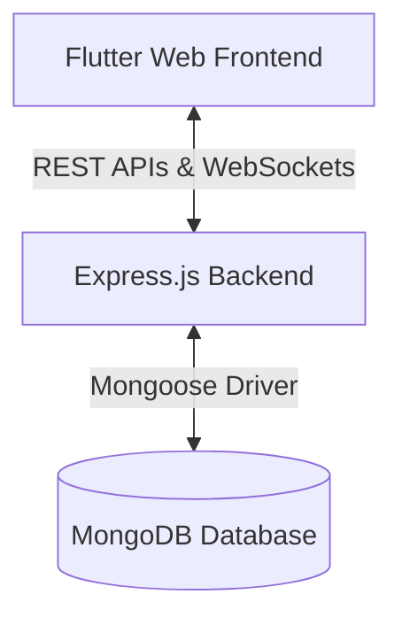

# Bike-Taxi System Handoff Documentation

Welcome to the **Bike-Taxi System** project (deployed under **DotTaxi** / **RideGo**). This document summarizes the architecture, design decisions, deployment guidelines, and testing steps for future maintenance and scaling.

---

## 📖 Table of Contents
1. [System Architecture](#-system-architecture)
2. [Tech Stack](#%EF%B8%8F-tech-stack)
3. [Features & Design System](#-features--design-system)
4. [Local Development Setup](#%EF%B8%8F-local-development-setup)
5. [Deployment Guide](#-deployment-guide)
6. [Verification & Sanity Checks](#-verification--sanity-checks)

---

## 🏗️ System Architecture
The application runs as a decoupled client-server architecture:


* **Frontend**: Compiled as a native HTML/JS SPA using Flutter Web. Communicates over HTTPS to backend endpoints and maintains a real-time full-duplex WebSocket link for active ride negotiations and driver status sync.
* **Backend**: Node.js/Express app running on Render. Orchestrates REST requests, handles real-time socket channels, and periodically scans for expired ride requests.

---

## 🛠️ Tech Stack
* **Frontend**: Flutter Web (Dart 3.x), standard browser APIs (`dart:html`) for persistent logins and location tracking.
* **Backend**: Node.js, Express, Socket.io, MongoDB, Mongoose, JSON Web Tokens (JWT) for secure authentication.
* **Hosting**: 
  - **Backend**: Render (connected to GitHub repository branch `main`).
  - **Frontend**: Vercel (distributing the `/frontend/bike_taxi_app/build/web` artifacts).

---

## 🎨 Features & Design System
### Sleek Premium Dark Mode Theme
Inspired by Google Stitch reference screens, the application uses a high-contrast dark theme:
* **Background**: Rich dark grey and pitch black (`0xFF121212`, `0xFF1E1E1E`).
* **Accents**: Neon green (`0xFF00FFCC`) for primary actions, driver status, and pickup location indicators; vibrant red (`0xFFFF3366`) for destructive options and drop location indicators.
* **Typography**: Outfit & Inter fonts mapped dynamically.

### Key Features
1. **Interactive Map**: Shows pickup/drop pins, active path polylines, and live-moving driver pins represented as custom bicycle icons.
2. **Persistent Location Cards**: Highlights green and red cards containing exact pickup/drop details across both Booking and Tracking screens.
3. **Simulated Google Login**: Provides single-click authentication matching user roles (rider vs. driver).
4. **Availability Sync**: Driver availability auto-enables upon logging in and disables (`isAvailable = false`) on logout.

---

## 🖥️ Local Development Setup

### 1. Backend Setup & Launch

You can run the backend from either the project root or the `/backend` folder:

1. **Install dependencies**:
   ```bash
   cd backend
   npm install
   ```

2. **(Optional) Configure `.env` file**:
   Create a `.env` file inside `/backend` (defaults to port `5000` and `mongodb://127.0.0.1:27017/biketaxi` if omitted):
   ```env
   PORT=5000
   MONGODB_URI=mongodb+srv://<user>:<password>@cluster.mongodb.net/biketaxi?retryWrites=true&w=majority
   JWT_SECRET=your_super_secret_jwt_key_here
   ```

3. **Start the backend**:
   ```bash
   # Development mode with auto-reload:
   npm run dev

   # Or standard production start:
   npm start
   ```
   > **Tip**: You can also run `npm run dev` or `npm start` directly from the project root.

---

### 2. Frontend & App Launch (2 Ways)

Depending on your goal, choose one of the following methods:

#### Method A: Instant Web App (No Flutter SDK Required) ⭐ Recommended
The Express backend is already configured to serve the pre-compiled Flutter Web build located at `frontend/bike_taxi_app/build/web`:
1. Start the backend (`npm run dev` or `npm start`).
2. Open your browser and go to:
   ```
   http://localhost:5000
   ```
   The complete ride-booking interface, REST APIs, and real-time WebSockets will run immediately in your browser without compiling Flutter.

---

#### Method B: Flutter Web Development Server (For Live Dart Code Editing)
If you want to edit the Flutter/Dart source code with hot-reload:

1. **Windows Prerequisite (Symlink Permission)**:
   Windows requires **Developer Mode** enabled so Flutter can link plugin dependencies.
   - Run in PowerShell:
     ```powershell
     start ms-settings:developers
     ```
   - Toggle **Developer Mode** to **On**.
2. **Navigate to the Flutter project folder** (*Important: this is `frontend/bike_taxi_app`, NOT just `frontend`*):
   ```bash
   cd frontend/bike_taxi_app
   ```
3. **Install Flutter packages**:
   ```bash
   flutter pub get
   ```
4. **Launch the web app in Chrome**:
   ```bash
   flutter run -d chrome
   ```
   *(Ensure the backend is running on `http://localhost:5000` so the Flutter app can connect to the local API).*

---

#### Method C: React + @mapcn/map Frontend (MapLibre GL + OSRM + Komoot Photon) 🚀
Modern GIS frontend built with React, Vite, TypeScript, Tailwind CSS, and `@mapcn/map`:
1. **Navigate to the React project folder**:
   ```bash
   cd frontend/react_app
   ```
2. **Install dependencies**:
   ```bash
   npm install
   ```
3. **Launch the dev server**:
   ```bash
   npm run dev
   ```
4. **Build for production**:
   ```bash
   npm run build
   ```
   *(The production bundle is generated in `dist/` and automatically served by Express at `http://localhost:5000`)*.

---

### ⚠️ Common Troubleshooting

* **`Error: No pubspec.yaml file found`**:
  Make sure you are in `frontend/bike_taxi_app`, not `frontend`.
* **`npm error Missing script: "dev"`**:
  `"dev": "node --watch server.js"` is configured in `package.json`. You can use either `npm run dev` or `npm start`.
* **`Building with plugins requires symlink support`**:
  Enable Developer Mode on Windows (`start ms-settings:developers`).
* **Port 5000 already in use (`EADDRINUSE`)**:
  If another local service is using port 5000, specify `PORT=5001` in your `backend/.env` file or terminate the conflicting process.

---

## 🚀 Deployment Guide

### Backend (Render)
1. Link your GitHub repository to **Render**.
2. Create a Web Service and select the root directory as `/` (our root `package.json` redirects scripts properly to backend).
3. Set the environment variables (`MONGODB_URI`, `JWT_SECRET`, `PORT`).
4. Render builds the backend using `npm install` and runs it using `npm start`.

### Frontend (Vercel)
1. Link your GitHub repository to **Vercel**.
2. Select the directory as `frontend/bike_taxi_app/build/web`.
3. Set build configuration commands to **empty** (or override to run nothing since Flutter build output is pushed directly).

---

## 🔍 Verification & Sanity Checks
Run the following steps to ensure system health:
1. Verify API responds to login pre-flight requests:
   ```bash
   curl.exe -s -X POST https://biketaxi.onrender.com/api/users/login
   ```
   *Expected response:* `{"message":"Cannot destructure property 'phone' of 'req.body' as it is undefined."}` (indicating server is up and listening to JSON requests).
2. Open `https://dottaxi.vercel.app` in Chrome to verify UI dark mode and responsiveness.
